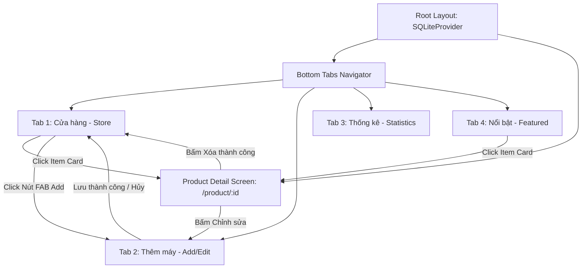
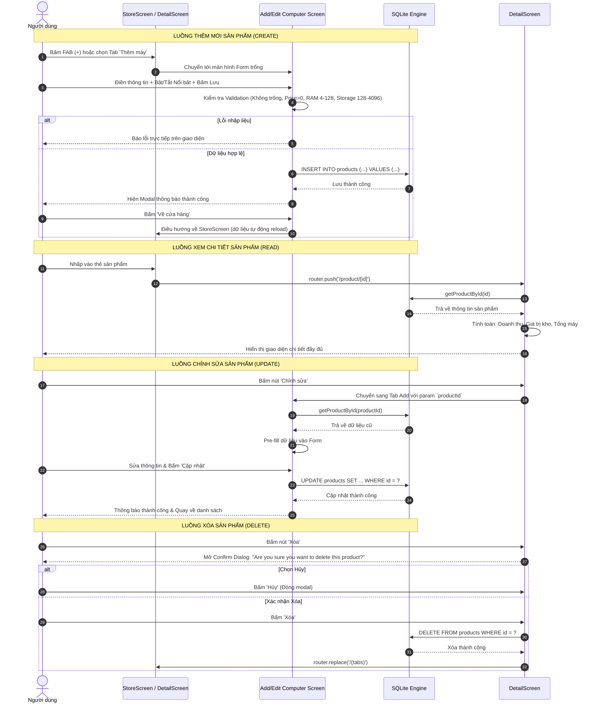
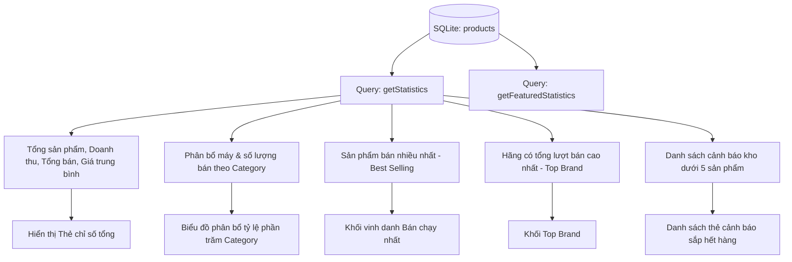

# BÁO CÁO DỰ ÁN & LUỒNG HOẠT ĐỘNG
## ỨNG DỤNG QUẢN LÝ CỬA HÀNG MÁY TÍNH (COMPUTER STORE MANAGEMENT APP - LAB 12)

---

### I. THÔNG TIN TỔNG QUAN

- **Tên dự án:** Computer Store Management App
- **Nền tảng:** React Native (Expo SDK 57), Mobile-first
- **Điều hướng (Navigation):** Expo Router (Tabs Navigator kết hợp Stack Navigator)
- **Cơ sở dữ liệu (Database):** SQLite cục bộ thông qua thư viện `expo-sqlite`
- **Bộ biểu tượng & Giao diện:** `@expo/vector-icons` (`Ionicons`), Color Palette Material Purple (`#6200EE`) theo chuẩn đề bài.

---

### II. CẤU TRÚC DỰ ÁN & PHÂN TẦNG KIẾN TRÚC

```text
ComputerStoreManager/
├── app/
│   ├── _layout.js              # Root Layout: Khởi tạo SQLiteProvider & Stack Screen
│   ├── (tabs)/                 # 4 Tab chính của Bottom Tab Navigator
│   │   ├── _layout.js          # Cấu hình thanh Bottom Tab (Icons, Màu sắc, Nhãn)
│   │   ├── index.js            # Tab 1: Cửa hàng (Store) - Danh sách, Tìm kiếm, Lọc, Sắp xếp, Nút FAB
│   │   ├── add.js              # Tab 2: Thêm mới / Chỉnh sửa máy tính (Form Validation)
│   │   ├── statistics.js       # Tab 3: Thống kê kinh doanh, Bán chạy, Top Brand, Biểu đồ
│   │   └── featured.js         # Tab 4: Sản phẩm nổi bật (Featured list & Statistics)
│   └── product/
│       └── [id].js             # Màn hình chi tiết sản phẩm + Tính toán kinh doanh + Xóa
├── src/
│   ├── database.js             # SQLite Engine: Khởi tạo bảng, Seeding, Truy vấn thống kê
│   ├── theme.js                # Bảng màu, Phân loại, Hàm định dạng tiền tệ và số nguyên
│   └── components/
│       └── Shared.js           # Các component tái sử dụng (ProductCard, StatCard, EmptyState,...)
├── package.json
└── BAO_CAO_DU_AN.md            # Báo cáo kỹ thuật và luồng hoạt động
```

---

### III. THIẾT KẾ CƠ SỞ DỮ LIỆU (DATABASE SCHEMA)

Dữ liệu được lưu trữ trong bảng `products` của SQLite với 11 trường thông tin theo đúng yêu cầu:

| Tên trường | Kiểu dữ liệu | Ràng buộc | Mô tả |
| :--- | :--- | :--- | :--- |
| `id` | `INTEGER` | `PRIMARY KEY AUTOINCREMENT` | Mã định danh sản phẩm tự tăng |
| `product_name` | `TEXT` | `NOT NULL` | Tên sản phẩm |
| `brand` | `TEXT` | `NOT NULL` | Hãng sản xuất (Apple, Dell, HP, Asus,...) |
| `category` | `TEXT` | `NOT NULL` | Loại sản phẩm (`Laptop`, `Desktop`, `Component`) |
| `cpu` | `TEXT` | `NOT NULL` | Tên bộ vi xử lý (CPU) |
| `ram` | `INTEGER` | `NOT NULL` | Dung lượng RAM (GB) |
| `storage` | `INTEGER` | `NOT NULL` | Dung lượng ổ cứng (GB) |
| `price` | `REAL` | `NOT NULL` | Đơn giá sản phẩm (USD) |
| `stock` | `INTEGER` | `NOT NULL DEFAULT 0` | Số lượng tồn kho hiện tại |
| `sold_quantity`| `INTEGER` | `NOT NULL DEFAULT 0` | Số lượng sản phẩm đã bán |
| `is_featured` | `INTEGER` | `NOT NULL DEFAULT 0` | Đánh dấu sản phẩm nổi bật (`1`: Có, `0`: Không) |

#### Chỉ mục tăng tốc (Performance Indexes):
- `products_name_idx`: Đánh chỉ mục trên `product_name COLLATE NOCASE` phục vụ tìm kiếm real-time cực nhanh.
- `products_category_idx`: Đánh chỉ mục trên trường `category` phục vụ lọc danh mục và gom nhóm thống kê.

#### Dữ liệu mẫu khởi tạo (Auto-seeding):
Hệ thống tự động nạp 4 sản phẩm mẫu khi cơ sở dữ liệu trống:
1. `MacBook Pro M3` (Apple / Laptop / Apple M3 / 16GB / 512GB / $1.800 / Kho 10 / Bán 30 / Nổi bật: 1)
2. `Dell XPS 13` (Dell / Laptop / Intel Core i7 / 16GB / 512GB / $1.500 / Kho 8 / Bán 20 / Nổi bật: 1)
3. `HP Pavilion` (HP / Desktop / Intel Core i5 / 8GB / 256GB / $800 / Kho 5 / Bán 15 / Nổi bật: 0)
4. `RTX 4060` (Asus / Component / GeForce RTX 4060 / 0GB / 0GB / $400 / Kho 3 / Bán 50 / Nổi bật: 1)

---

### IV. SƠ ĐỒ LUỒNG HOẠT ĐỘNG TOÀN DỰ ÁN

#### 1. Luồng Điều hướng Tổng thể (Navigation Architecture)



---

#### 2. Luồng Nghiệp vụ CRUD Sản phẩm



---

#### 3. Luồng Tìm kiếm, Lọc và Sắp xếp (Search, Filter, Sort Pipeline)

Tại Tab Cửa hàng (`index.js`), toàn bộ dữ liệu phản hồi thời gian thực qua cơ chế lọc dạng đường ống (Pipeline):

```mermaid
graph LR
    Raw[Dữ liệu gốc từ SQLite] --> S1[1. Search real-time theo product_name]
    S1 --> S2[2. Filter theo Brand]
    S2 --> S3[3. Filter theo Category]
    S3 --> S4[4. Filter tình trạng kho: Còn hàng, Sắp hết, Hết hàng]
    S4 --> S5[5. Filter theo mức RAM: 8GB, 16GB, 32GB+]
    S5 --> S6[6. Filter khoảng giá: <$500, $500-1000, >$1000]
    S6 --> S7[7. Toggle chỉ lấy sản phẩm nổi bật]
    S7 --> Sort[8. Sắp xếp: Giá tăng/giảm, Bán chạy tăng/giảm, Tên A-Z]
    Sort --> Render[Hiển thị danh sách FlatList]
```



---

#### 4. Luồng Tính toán & Báo cáo Thống kê (Statistics Engine)



---

### V. CÔNG THỨC NGHIỆP VỤ & TÍNH TOÁN

Tại màn hình Chi tiết sản phẩm ([app/product/[id].js](file:///d:/K%C3%AC%207%20CODE/MMA392_LAB/ComputerStoreManager/app/product/%5Bid%5D.js)) và Thống kê ([app/(tabs)/statistics.js](file:///d:/K%C3%AC%207%20CODE/MMA392_LAB/ComputerStoreManager/app/%28tabs%29/statistics.js)), ứng dụng áp dụng chính xác các công thức:

1. **Doanh thu từng sản phẩm (Product Revenue):**
   $$\text{Revenue} = \text{price} \times \text{sold\_quantity}$$
2. **Giá trị tồn kho (Inventory Value):**
   $$\text{Inventory Value} = \text{price} \times \text{stock}$$
3. **Tổng số máy từng nhập (Total Units):**
   $$\text{Total Units} = \text{stock} + \text{sold\_quantity}$$
4. **Tổng doanh thu toàn cửa hàng (Total Revenue):**
   $$\text{Total Revenue} = \sum (\text{price} \times \text{sold\_quantity})$$
5. **Giá trung bình sản phẩm (Average Price):**
   $$\text{Average Price} = \text{AVG}(\text{price})$$
6. **Sản phẩm bán chạy nhất (Best Selling Product):**
   Truy vấn lấy bản ghi có `sold_quantity` lớn nhất:
   `SELECT * FROM products ORDER BY sold_quantity DESC LIMIT 1`
7. **Hãng có doanh số cao nhất (Top Brand):**
   Truy vấn nhóm theo hãng và tính tổng số lượng bán:
   `SELECT brand, SUM(sold_quantity) AS sold_quantity FROM products GROUP BY brand ORDER BY sold_quantity DESC LIMIT 1`
8. **Danh sách sản phẩm sắp hết hàng (Low Stock List):**
   Lọc tất cả sản phẩm có `stock < 5` và sắp xếp theo tồn kho tăng dần.

---

### VI. ĐỐI CHIẾU TIÊU CHUẨN UI/UX & ICON CHEAT SHEET

Dự án đã đồng bộ 100% theo tài liệu hướng dẫn biểu tượng (Trang 7 đến 10 của đề bài):

| Màn hình | Mục hiển thị | Icon chuẩn | Kích thước | Tình trạng áp dụng |
| :--- | :--- | :--- | :---: | :---: |
| **Store Tab** | Empty State | `laptop-outline` | 80 | Đã áp dụng |
| | Nút FAB thêm nhanh | `add` | 28 | Đã tích hợp góc dưới bên phải |
| | Đơn giá | `pricetag-outline` | 18 | Đã áp dụng |
| | Trạng thái kho | `close-circle` / `alert-circle` / `checkmark-circle` | 18-20 | Đã áp dụng theo màu logic |
| | Đã bán | `bar-chart-outline` | 16 | Đã áp dụng |
| | Nổi bật | `flame` | 20 | Đã áp dụng |
| | Bộ vi xử lý | `hardware-chip-outline` | 16 | Đã áp dụng |
| | Bộ nhớ RAM | `flash-outline` | 16 | Đã áp dụng |
| | Ổ cứng lưu trữ | `save-outline` | 16 | Đã áp dụng |
| | Mũi tên điều hướng | `chevron-forward` | 18 | Đã áp dụng |
| **Add / Edit** | Header màn hình | `laptop-outline` | 46 | Đã áp dụng |
| | Tên sản phẩm | `create-outline` | 18 | Đã áp dụng |
| | Hãng | `pricetags-outline` | 18 | Đã áp dụng |
| | Loại sản phẩm | `settings-outline` | 18 | Đã áp dụng |
| | CPU | `hardware-chip-outline` | 18 | Đã áp dụng |
| | Ổ cứng | `save-outline` | 18 | Đã áp dụng |
| | Nút Lưu | `checkmark-circle` | 20 | Đã áp dụng |
| | Nút Hủy | `close-circle` | 20 | Đã áp dụng |
| **Detail** | Header Hero | `desktop-outline` | 46 | Đã áp dụng |
| | CPU | `hardware-chip` | 20 | Đã áp dụng |
| | Doanh thu | `stats-chart-outline` | 20 | Đã áp dụng |
| | Giá trị tồn kho | `cube` | 20 | Đã áp dụng |
| | Tổng số máy | `add-circle-outline` | 20 | Đã áp dụng |
| | Nút Sửa | `create-outline` | 20 | Đã áp dụng |
| | Nút Xóa | `trash-outline` | 20 | Đã áp dụng |
| | Nút Quay lại | `arrow-back-outline` | 21 | Đã áp dụng |
| **Statistics**| Thẻ Bán chạy nhất | `trophy-outline` | 24 | Đã áp dụng |
| | Thẻ Top Brand | `business-outline` | 24 | Đã áp dụng |
| | Mục Sắp hết hàng | `alert-circle-outline` | 22 | Đã áp dụng |
| | Phân bổ danh mục | `CategoryDistributionBar` | - | Tích hợp biểu đồ trực quan (Bonus) |
| **Featured** | Thẻ Tổng nổi bật | `star` | 24 | Đã áp dụng |
| | Thẻ Doanh thu | `cash` | 24 | Đã áp dụng |
| | Thẻ Đã bán | `stats-chart` | 24 | Đã áp dụng |
| | Tiêu đề danh mục | `grid-outline` | 20 | Đã áp dụng |

---

### VII. HƯỚNG DẪN KHỞI CHẠY VÀ KIỂM THỬ

```bash
# 1. Cài đặt các gói phụ thuộc nếu cần
npx expo install

# 2. Kiểm tra chất lượng mã nguồn (Linter)
npm run lint

# 3. Khởi chạy dev server Expo
npx expo start
```

- Bấm `a` để mở trên thiết bị / máy ảo Android.
- Bấm `w` để chạy thử trực tiếp trên Web Browser.
- Quét mã QR bằng ứng dụng **Expo Go** trên điện thoại thực.
